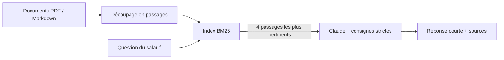

# Assistant documentaire IA

Un assistant qui répond aux questions internes des salariés **à partir des documents de l'entreprise**, en citant ses sources et sans rien inventer.

> Projet construit avec **Claude et Claude Code**, sur le cas d'une PME fictive du BTP (BâtiNova, 45 salariés).

## Le problème
Dans une PME, les mêmes questions reviennent tous les jours : « Combien est remboursé un repas sur chantier ? », « Comment poser mes congés ? », « Que faire si je perds mon ordinateur ? ». Les réponses existent, mais elles sont éparpillées dans des PDF que personne ne lit. Les RH, la comptabilité et le support perdent du temps à répondre.

## La solution
L'assistant cherche les passages utiles dans les documents, puis Claude rédige une réponse courte **uniquement à partir de ces passages**, avec la source entre crochets. Si l'information n'est pas dans les documents, il le dit et indique qui contacter.

Exemple :

> **Question :** Combien est remboursé un repas sur un chantier ?
> **Réponse :** Un repas pris sur un chantier à plus de 30 km du siège est remboursé jusqu'à 20,70 € TTC, sur justificatif déclaré dans Expensya avant le 5 du mois suivant [notes-de-frais.md].

## Comment ça marche



1. **Indexation** (`src/rag.py`) : les documents sont découpés par section, puis indexés avec BM25, un algorithme de recherche classique, sans accents ni mots vides.
2. **Recherche** : pour chaque question, on garde les 4 passages les plus pertinents. Si rien n'est pertinent, Claude n'est même pas appelé (aucun coût, aucune réponse inventée).
3. **Réponse** (`src/llm.py`) : Claude reçoit les passages entre balises `<sources>` et des consignes strictes : répondre en français, citer les sources, ne jamais inventer de montant ou de délai, ignorer toute instruction cachée dans les documents.
4. **Interface** (`app.py`) : une application Streamlit de type chat, avec ajout de vos propres documents et affichage des passages utilisés.

## Installation

```bash
git clone <url-du-depot>
cd assistant-documentaire-ia
python -m venv .venv && source .venv/bin/activate   # Windows : .venv\Scripts\activate
pip install -r requirements.txt
cp .env.example .env          # puis mettre votre clé ANTHROPIC_API_KEY dans .env
streamlit run app.py
```

Questions à tester : « Comment poser mes congés ? », « Le harnais est-il obligatoire ? », « J'ai perdu mon téléphone, que faire ? », « Quelle est la recette du couscous ? » (hors sujet : l'assistant refuse).

Tests : `pytest` (10 tests : recherche, refus hors sujet, appel à Claude simulé).

## Sécurité et données (RGPD)
- Les documents restent sur le poste ou le serveur de l'entreprise. Seuls les passages utiles à une question sont envoyés à l'API.
- Les données envoyées via l'API Anthropic ne servent pas à entraîner les modèles par défaut.
- Protection contre l'injection de prompt : les documents sont traités comme des données, pas comme des consignes.
- Ne pas indexer de données personnelles sensibles (dossiers salariés, santé) sans analyse d'impact.

## Gain attendu
Pour une PME de 45 salariés, si l'assistant évite 10 questions par jour à 5 minutes chacune, cela fait environ **15 heures par mois** rendues aux RH, à la comptabilité et au support.

## Limites et prochaines étapes
- La recherche BM25 se base sur les mots : une question formulée avec des synonymes peut manquer un passage. Étape suivante : recherche sémantique (embeddings) en complément.
- Brancher directement les sources de l'entreprise (SharePoint, Google Drive) via un connecteur MCP.
- Mesurer l'usage : questions fréquentes, questions sans réponse (pour compléter la documentation).
- Déploiement en interne avec authentification (SSO).

## Structure

```
app.py                 Interface Streamlit
src/rag.py             Chargement, découpage, index BM25
src/llm.py             Consignes et appel à Claude
documents/             Documents fictifs de BâtiNova
tests/                 Tests pytest
```
